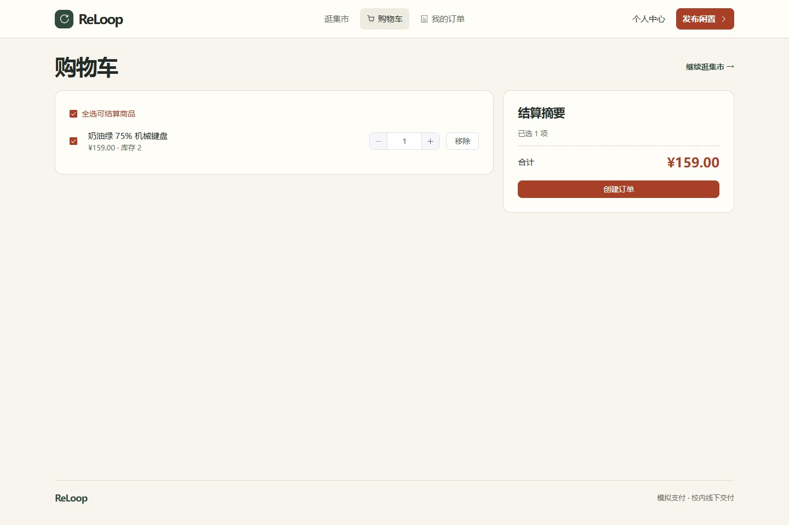
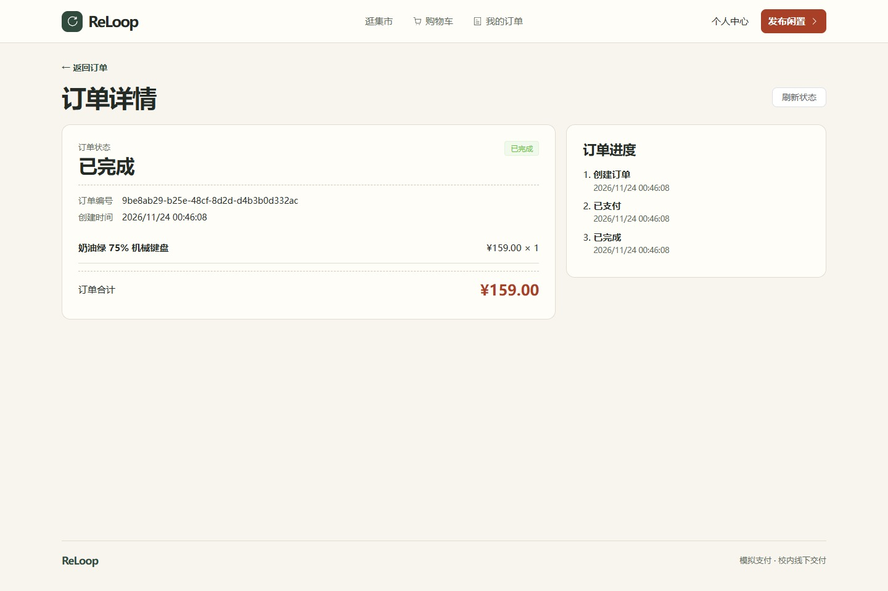
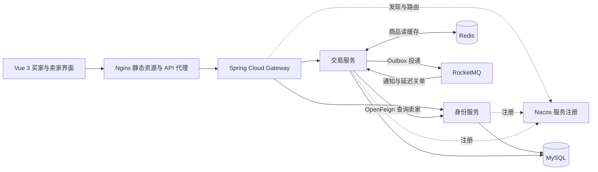

# ReLoop 校园二手交易与履约

ReLoop 让校园卖家发布闲置，让买家在同一个流程里查找商品、结算、模拟付款并确认交付。项目重点是交易数据的一致性、缓存与数据库的取舍，以及消息到达前后的业务状态。


| 商品详情 | 购物车 | 订单小票 |
| --- | --- | --- |
| [](docs/showcase/screenshots/desktop/03-product.jpg) | [](docs/showcase/screenshots/desktop/04-cart.jpg) | [](docs/showcase/screenshots/desktop/05-order.jpg) |

[搜索与分类](docs/showcase/screenshots/desktop/02-search.jpg) · [商品详情](docs/showcase/screenshots/desktop/03-product.jpg) · [购物车](docs/showcase/screenshots/desktop/04-cart.jpg) · [订单小票](docs/showcase/screenshots/desktop/05-order.jpg) · [手机界面](docs/showcase/screenshots/mobile/01-market.jpg)

## 交易流程

卖家发布、编辑和上下架商品。买家按分类和关键词检索，在购物车选择商品后创建订单，模拟支付、确认交付或取消。订单页面显示商品快照、金额、真实订单状态与通知。示例目录由后端接口提供，公开演示数据和工作库隔离。

## 系统架构



| 层 | 技术 |
| --- | --- |
| 后端与存储 | Java 17、Spring Boot、Spring Security、MyBatis、MySQL |
| 缓存与消息 | Redis、Spring Cache、RocketMQ、事务 Outbox |
| 服务协作 | Spring Cloud Gateway、Nacos、OpenFeign、MDC traceId |
| 前端与部署 | Vue 3、Vite、Element Plus、Nginx、Docker Compose |

## 工程亮点与量化结果

| 业务问题 | 方案与实现 | 实测证据 |
| --- | --- | --- |
| 多人争抢末件与重复结算 | 事务内执行有条件的库存更新，按买家及幂等键约束订单；取消或过期回补 | 12 路争抢同一件库存仅 1 路成功，12 次同键请求只产生一笔订单 |
| 热门商品读流量 | Redis 缓存商品明细及热门列表，写入后按已有策略失效 | 固定本地压测 806.23 → 3,006.26 请求/秒，P95 12.21 → 4.76 ms |
| 交易成功后消息投递失败 | 同一数据库事务写业务与 Outbox，后台重试；消费以业务键去重 | 历史 Broker 故障后完成补投，通知仅保存一条，短 TTL 验证归还库存 |
| 跨服务查不到卖家 | Gateway 路由，Nacos 注册与发现，Commerce 经 OpenFeign 查身份，MDC 贯通 traceId | 历史验证串联三个进程，依赖不可用时统一返回 503 |

以上为合成数据和本地指定环境实测。Redis 对照使用约 3 万在售商品、8 并发连接及三轮中位数。本轮 GitHub 展示仅运行适用回归。 [量化口径与验收证据](docs/showcase/verification.md)

## 启动与验证

使用支持 Linux 容器的 Docker Engine 和 Docker Compose。以下从仓库根目录在 PowerShell 执行。初次启动由现有脚本生成本地随机配置。

```powershell
if (!(Test-Path deploy/.env)) { .\deploy\New-LocalSecrets.ps1 }
docker compose --env-file deploy/.env -f deploy/compose.yml up -d --build --wait
```

打开 [ReLoop](http://127.0.0.1:8088)。用不同 Compose 项目名和独立卷启动公开目录。 [隔离演示指南](docs/showcase/demo-guide.md)

本地联调可用现有 [API 契约](docs/api/contract.md) 和 [架构说明](docs/architecture/design.md)。准备独立 MySQL，执行 [初始化 SQL](database/schema/001_init.sql)，在后端进程环境设置 DB_URL、DB_USER、DB_PASSWORD 和 JWT_SECRET。根目录运行 Maven，另开终端运行 Vue。

```powershell
mvn -f backend/pom.xml spring-boot:run
# 另一个终端，在 frontend 中运行
npm ci
npm run dev -- --host 127.0.0.1
```

在隔离环境执行现有测试。API 与浏览器测试会创建账号、商品和订单。

```powershell
mvn -f backend/pom.xml -Dtest=OrderServiceTest test
python tests/api/exercise.py --base http://127.0.0.1:8088 --workers 12
$env:CAMPUS_FRONTEND_URL = 'http://127.0.0.1:8088'
Push-Location frontend
npm ci
npx playwright install chromium
npm run test:e2e
Pop-Location
```

项目目录包括 backend、gateway、frontend、database、deploy、tests 与 docs。支付为模拟流程。实际支付及物流接入属于后续扩展。 [素材来源](docs/showcase/assets-license.md)
