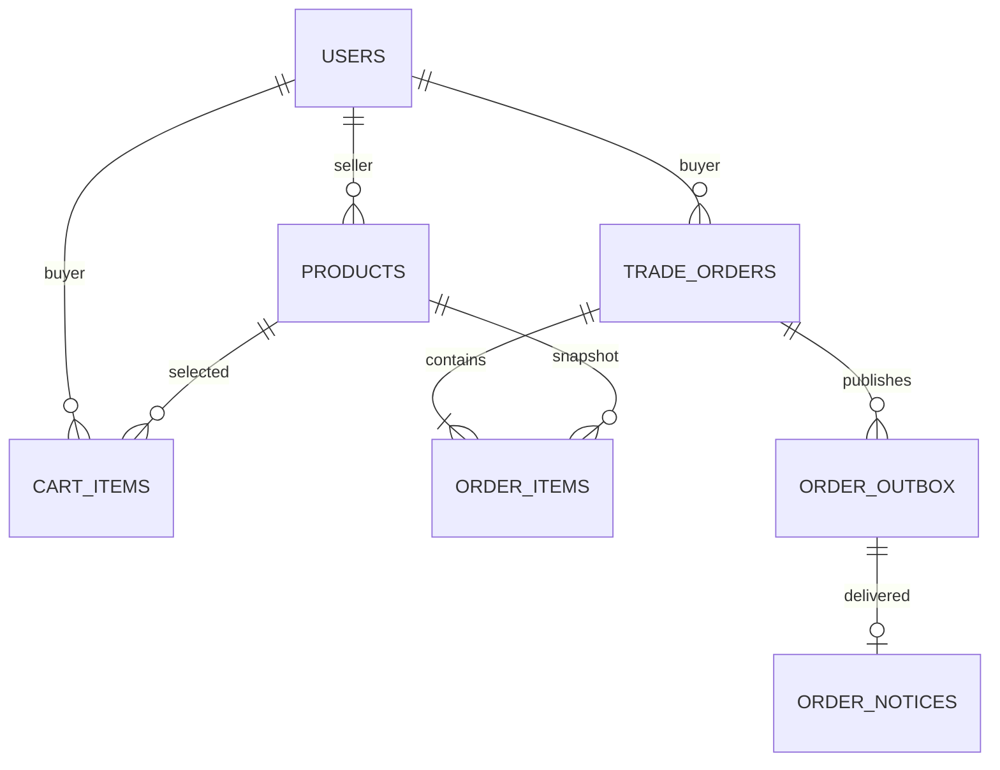

# 系统与数据设计

## 服务边界

第一版从统一 Spring Boot 进程验证交易。在微服务部署中，网关通过 Nacos 发现身份服务和交易服务。身份服务管理账号、凭证和角色。交易服务管理商品、购物车、订单及库存，使用 OpenFeign 向身份服务查询卖家公开资料。服务间传递 traceId，身份由各业务服务独立校验签名和权限。默认所有公开请求通过网关或开发代理进入。

商品、库存和订单属于同一交易一致性边界。订单与库存预留使用 MySQL 本地事务。按商品 ID 顺序更新库存，库存扣减使用带库存和状态条件的 SQL。订单操作在行锁与事务内更新状态，作为支付、取消、完成与超时之间唯一的并发裁决点。快照保证商品编辑或下架不影响订单历史。

账号标识的跨服务关联为逻辑外键。交易内的购物车、明细和消息使用数据库外键。金额用 DECIMAL(12,2)，时间以 UTC 存储。订单号对外使用 UUID。购物车以买家和商品联合主键存储。创建订单的幂等键按买家隔离，保存请求指纹以检测误复用。

## 状态与异步交付

待支付 → 已支付 → 已完成。待支付可进入已取消或已超时。后三种结束状态各自终止。订单事务写入待发送消息，投递失败由后台重试。RocketMQ 延迟消息触发超时处理，锁定订单并条件变更状态，重复消息可安全重投。普通事件以事件 ID 写入用户站内通知。

Redis 缓存只承载商品读取。商品变更事务提交后失效，短 TTL 限制读写竞争下陈旧数据窗口。库存和价格以结算事务中的 MySQL 数据为准。
