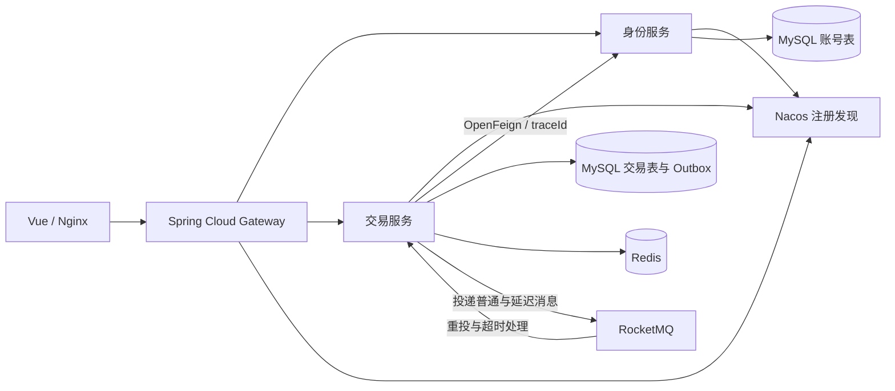

# 部署边界与故障处理

两个业务服务由同一 Maven 构建生成，可分别激活 `identity` 和 `commerce` 配置启动。两个服务共用 MySQL 实例，Compose 使用不同账号和表授权落实数据边界。内部卖家接口使用独立的服务密钥，且没有网关路由。JWT 由身份服务签发，由业务服务校验。部署服务之间应保持网络隔离，本地配置仅将 Nginx 绑定宿主机回环。

订单事务内写订单、明细、库存和 Outbox。投递进程锁定一条待发送事件，Broker 确认后标记已发送。投递失败保留消息并按 1–60 秒退避。进程在消息发送与数据库标记之间退出时可产生重复消息，站内通知以事件 ID 为主键，超时关闭以行锁和状态判断做幂等。Broker 消费失败由 RocketMQ 重投，长期失败可查看消费组重试队列及死信队列。辅助扫描在订单过期 30 秒后兜底关闭，延迟消息为正常路径。

商品详情与卖家摘要缓存 60 秒，空值缓存 10 秒，首页和分类热门列表缓存 30 秒。变更提交后失效，包括结算及取消造成的库存变化。Redis 不可用时读取 MySQL，缓存异常记录到日志。缓存一致性目标为最终一致，受并发读写和 TTL 限制。订单结算始终读取并锁定数据库记录。

Servlet 请求、Feign 请求、网关入口和消息记录共享 `X-Trace-Id`。事件把 traceId 保存在 Outbox，消费或重试时可用事件主键和 traceId 对应业务请求。应用日志不会主动输出 JWT、账户密码或内部服务凭证。
